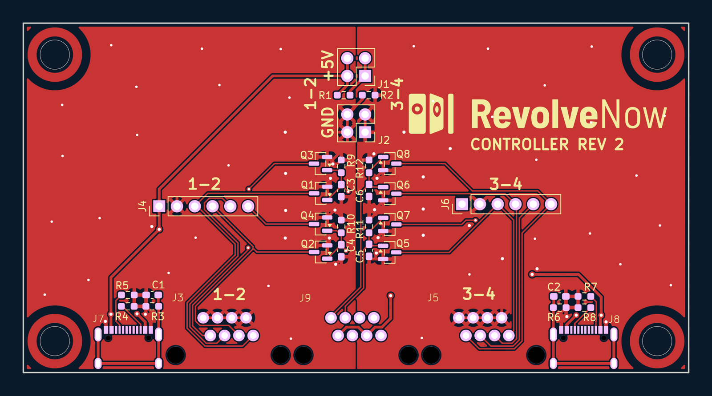
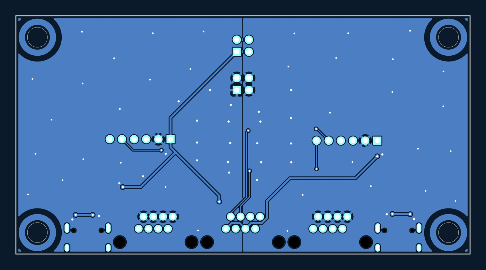
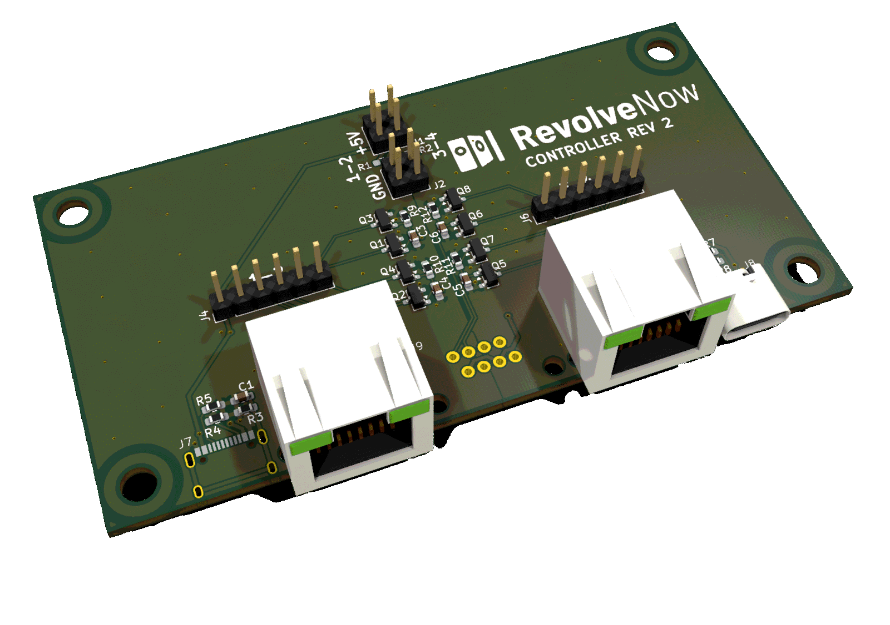

# Controller board

The Revolve Now controller board (the relay box), rev 2. It has no
microcontroller: eight LGE2300 N-channel MOSFETs (`Q1`–`Q8`) switch the target
outputs low, driven from the inputs on `J9`. The board is two halves, labelled
**1–2** and **3–4** on the silkscreen, each with its own USB-C power input,
output RJ45 and output header. 95 × 50 mm, two copper layers.

## Connectors

| Ref | Part | Role |
|---|---|---|
| `J3` | RJ45 | Outputs of half 1–2: the drains of `Q1`–`Q4` on pins 1, 3, 5, 7, ground on 2, 4, 6, 8 |
| `J5` | RJ45 | Outputs of half 3–4, the same way, from `Q5`–`Q8` |
| `J4`, `J6` | 1×6 pin header | +5 V, GND and the four outputs of half 1–2 and 3–4 |
| `J7`, `J8` | USB-C | 5 V power for half 1–2 and 3–4. Power only: the data lines are not connected |
| `J9` | RJ45 | Manual remote control: +5 V on pins 1, 3, 5, 7, MOSFET gates on 2, 4, 6, 8 |
| `J1`, `J2` | 2×2 pin header | Jumpers that join the +5 V (`J1`) and the GND (`J2`) of the two halves. `R1` and `R2`, 0 Ω and not fitted, do the same |

Each `J9` pair drives two MOSFETs, so one input switches two outputs:

| `J9` pins | MOSFETs | Outputs |
|---|---|---|
| 1–2 | `Q1`, `Q3` | `J3` pins 1 and 5 |
| 3–4 | `Q2`, `Q4` | `J3` pins 3 and 7 |
| 5–6 | `Q5`, `Q7` | `J5` pins 1 and 5 |
| 7–8 | `Q6`, `Q8` | `J5` pins 3 and 7 |

## Files

| Path | What it is |
|---|---|
| `revolvenow_controller.kicad_pro` | The KiCad project. Open this one, in KiCad 10 |
| `revolvenow_controller.kicad_sch` | Root schematic: the Controller sheet, and `power1.kicad_sch` and `output1.kicad_sch` each used twice, once per half |
| `revolvenow_controller.kicad_pcb` | The board |
| `fab/rev2/` | What was sent to the fab, described in the [hardware README](../README.md#fabrication-output) |

Footprints from the shared library come from [`../lib/`](../lib/) through
`fp-lib-table`.

Open items in the design are tracked in the
[rev 2 review on #603](https://github.com/Malmo-Skyttegille-Pistolsektionen/revolve_now/pull/603#issuecomment-6858837484).
