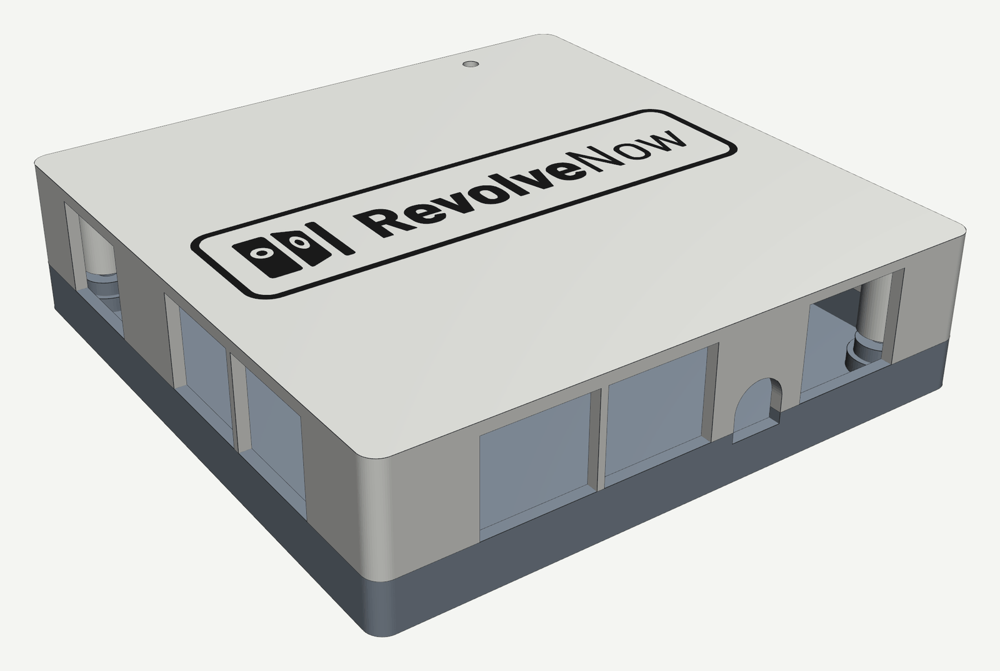
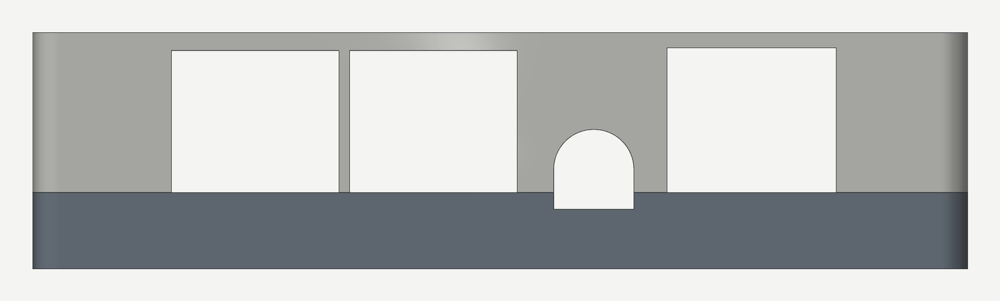
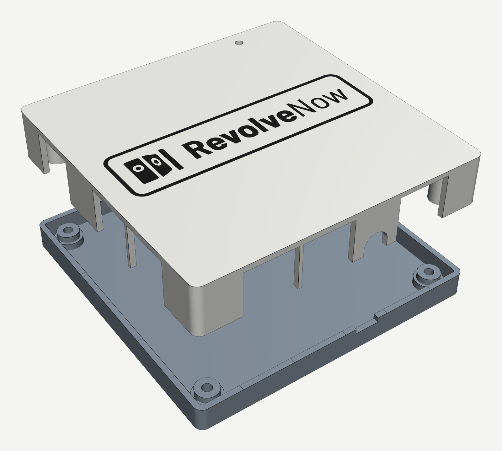

# Enclosure

A 3D-printable box for the rev 2 main board: a base tray the board screws into and a lid that drops over the connectors. The Revolve Now logo sits in a rounded frame on the lid, printed in a second colour. Four screws hold it together from underneath, so the top shows no screws.



## Files

| Path | What it is |
|---|---|
| `src/enclosure.py` | The parametric model and the only source. Every dimension is a named constant at the top |
| `src/enclosure.FCStd` | The same model in FreeCAD, with stand-ins for the board and its tall parts in a `FitCheck` group |
| `generated/enclosure.3mf` | For Bambu Studio and OrcaSlicer. Both parts on one plate, laid out as printed: the base as modelled, the lid upside down beside it, the logo a part of the lid on filament 2. Plate footprint 220 × 105 mm. It holds geometry and filament assignments only, no printer or process settings |
| `generated/enclosure-{base,lid,logo}.stl` | Each part as a mesh, in the assembled position, for slicers or printing services that only take STL |

Everything under `generated/` is written by the script; edit `src/enclosure.py` and regenerate rather than changing an export.

## What it fits

The positions come from the rev 2 layout, `hardware/main/revolvenow_main.kicad_pcb` (PR #436). Board coordinates run X 0..100 from the J8/J6/J3 edge and Y 0..100 from the connector edge.

- **Connector edge (front):** J1 and J2 (Turn 0-3 and 4-7 RJ45s), the J7 audio jack and the U11 Ethernet MagJack.
- **Left edge:** J8 and J6 (Turn 12-15 and 8-11 RJ45s) and J3 (Trigger RJ45).
- **USB-C edge (right):** J4.
- **Back edge:** closed. The ESP32 module sits inside the board outline with its antenna over a notch in the board, so nothing pokes out.
- **Status LED:** a 3 mm hole in the lid top over D8, the WS2812B. Set `LED_WINDOW_D = 0` for a closed lid.
- **Mounting:** the four 4.7 mm corner holes, at 5.5 mm from each board edge.
- **Logo:** the logo inside a rounded-rectangle frame, 80 mm wide and 0.6 mm deep in the lid top, upright when the connector edge faces you. It is read from `webapp/public/revolve-now-logo.svg` at generation time, so the box follows the web app's logo. The `logo` part fills it flush.

The J5 UART header and the J9 jumper header stay inside; take the lid off to reach them.

## Dimensions

| | mm | Constant |
|---|---|---|
| Outside | 105 × 105 × 26.6 | derived |
| Base height, floor to split line (the board's top face) | 8.6 | `FLOOR + STANDOFF_H + PCB_T` |
| Lid height | 18.0 | `HEADROOM + LID_T` |
| Walls, floor, lid top | 2.0 | `WALL`, `FLOOR`, `LID_T` |
| Board edge to inner wall | 0.5 | `GAP` |
| Outer corner radius | 3.0 | `R_OUT` |
| Floor to board underside | 5.0 | `STANDOFF_H` |
| Board top to lid underside | 16.0 | `HEADROOM` |
| Standoff and lid post diameter | 8.0 | `BOSS_D` |
| Standoff foot round the counterbore | 10.0 | `FOOT_D` |

Measured from the generated solids: base 28.1 cm³, lid 33.4 cm³, logo 0.4 cm³.

## Openings



Positions are along the side in board coordinates, heights from the board's top face. Sizes include the clearance: at least 1 mm round each connector body. Every opening is a notch open towards the split line, so the lid drops over the connectors.

| Connector | Side | Centre | Opening | Constant |
|---|---|---|---|---|
| J1 RJ45 Turn 0-3 | front | 22.5 | 18.8 wide × 16.0 tall | `OPENINGS` |
| J2 RJ45 Turn 4-7 | front | 42.5 | 18.8 × 16.0 | `OPENINGS` |
| J7 audio PJ-320A | front | 60.5 | Ø9.0, axis 2.6 above the board, open down into the base | `OPENINGS` |
| U11 Ethernet MagJack | front | 78.215 | 19.0 × 16.3 | `OPENINGS` |
| J4 USB-C | right | 84.71 | 14.5 × 9.0 slot, R2.5 corners, centre 1.63 above the board | `OPENINGS` |
| J8 RJ45 Turn 12-15 | left | 23.0 | 18.8 × 16.0 | `OPENINGS` |
| J6 RJ45 Turn 8-11 | left | 43.0 | 18.8 × 16.0 | `OPENINGS` |
| J3 RJ45 Trigger | left | 79.0 | 18.8 × 16.0 | `OPENINGS` |
| D8 status LED | lid top | X 80.5, Y 96.7 | Ø3.0 | `STATUS_LED`, `LED_WINDOW_D` |

The ribs between J1 and J2, and between J8 and J6, are 1.2 mm wide. They print, but handle the lid with care until the connectors are in them.

## Printing



- **No supports needed.** `enclosure.3mf` has both parts the right way up: the base as modelled, the lid upside down. The counterbores under the base have one-layer bridging steps (`LAYER`, 0.2 mm) so their ceilings print clean.
- **Logo colour:** the logo is on filament 2 and the rest on filament 1; pick any colour for either in the slicer. Since the lid prints face down, the logo and frame are its first three layers at 0.2 mm. With a single filament, set both to the same one, or pause at 0.6 mm to swap.
- **On a Bambu Lab P2S:** the plate footprint, 220 × 105 mm, fits its 256 × 256 mm plate. The 3MF carries no printer or process settings, so choose the printer, `0.20mm Standard`, which matches the 0.2 mm bridging steps, and the filaments when it opens.

## Hardware and assembly

- **Screws:** 4 × M3×12 socket-head screws (ISO 4762; M3×10 to M3×20 fit), in Ø3.4 clearance holes.
- **Inserts:** 4 × M3 × 5.7 heat-set inserts. Press one into the end of each lid post (Ø4.0 hole, 6 mm deep), flush with the end.
- **Assembly:** lay the board on the standoffs, put the lid on, turn the box over and drive the screws up through the base into the inserts. The heads sit flush in Ø6.0 × 3.2 mm counterbores in the base's underside, and the lid top stays closed.

## Check before printing

The KiCad project has no 3D models, so connector heights and face widths are typical datasheet values, not measurements:

| Part | Assumed | Constant |
|---|---|---|
| RJ45 J1/J2/J3/J6/J8 | 16 mm wide, 13.5 mm tall | `OPENINGS`, `FIT` |
| MagJack U11 | 16.2 mm wide, 13.6 mm tall | `OPENINGS`, `FIT` |
| Audio J7 | barrel axis 2.6 mm above the board | `OPENINGS` |
| USB-C J4 | connector centre 1.63 mm above the board | `OPENINGS` |
| Pin headers J5/J9 | 8.5 mm tall with a jumper on | `FIT` |

The openings are deliberately generous for a first test print. Tighten them in `OPENINGS` once a print fits. Measure the board you have, update the constants, and regenerate.

## Regenerating

With FreeCAD 1.1 (`freecadcmd` ships with it; the AppImage takes it as its first argument):

```bash
freecadcmd hardware/enclosure/src/enclosure.py
# or: FreeCAD.AppImage freecadcmd hardware/enclosure/src/enclosure.py
```

This rewrites `src/enclosure.FCStd` and everything in `generated/`. The script refuses to save a part that isn't a single closed, manifold solid, and it also fails if a stand-in collides with the walls. The STL and 3MF bytes are reproducible: an unchanged model regenerates identical files.
