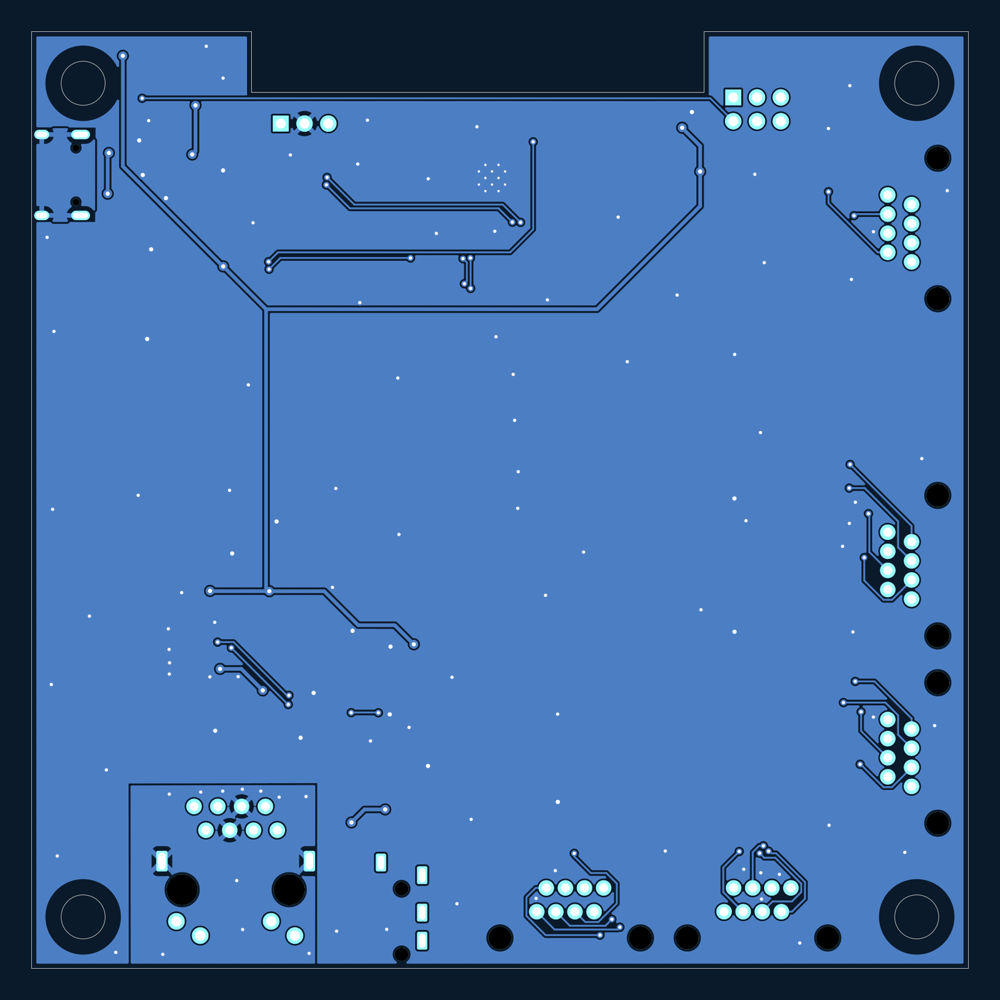
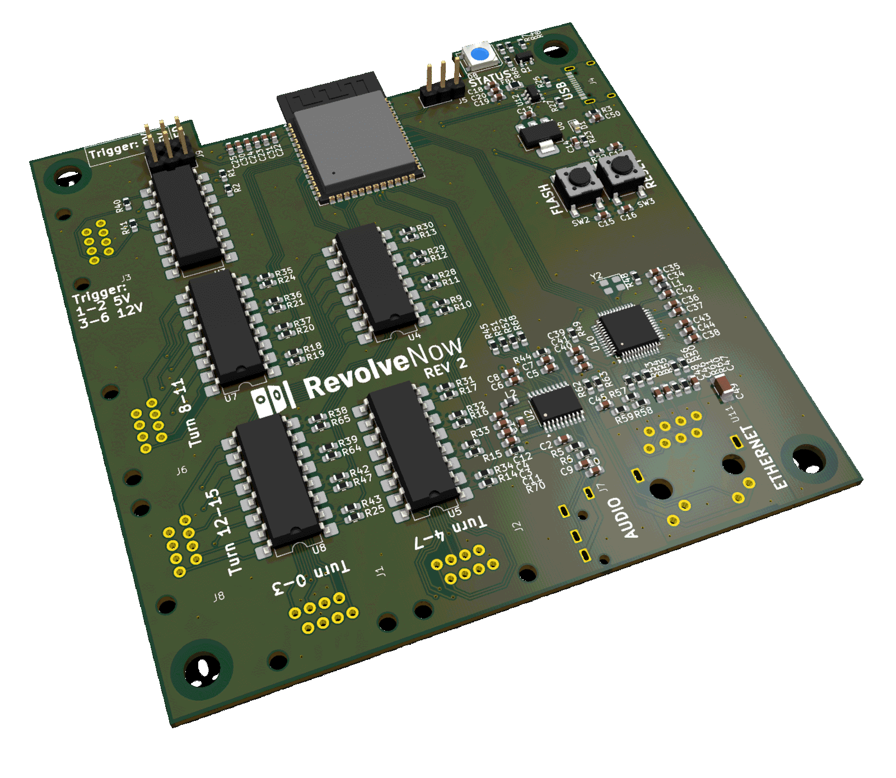

# Main board

The Revolve Now main board, rev 2. An ESP32-S3-WROOM-1 (`U1`) drives sixteen
opto-isolated target outputs, reads two opto-isolated trigger inputs, talks to
the network over WiFi or a W5500 Ethernet controller (`U10`), and plays the
range commands through a PCM5102A DAC (`U2`). One WS2812B (`D8`) is the status
LED. 100 × 100 mm, two copper layers.

## Connectors

| Ref | Part | Role |
|---|---|---|
| `J1`, `J2`, `J6`, `J8` | RJ45 | Target outputs Turn 0–3, 4–7, 8–11 and 12–15, through the LTV-847 optocouplers `U4`, `U5`, `U7` and `U8` |
| `J3` | RJ45 | Trigger inputs through the LTV-847 `U3`: pins 1–2 for a 5 V signal, pins 3–6 for 12 V |
| `J4` | USB-C | 5 V power, and the ESP32-S3's native USB (GPIO19/20) behind the USBLC6-2SC6 `U12` |
| `J5` | 1×3 pin header | UART0: RX, GND, TX |
| `J7` | 3.5 mm jack (PJ-320A) | Line out from the DAC |
| `J9` | 2×3 pin header | Jumper that puts GPIO4 on the status LED data (pins 1–2), trigger 0 (3–4) or trigger 1 (5–6) |
| `U11` | RJ45 with magnetics (J0026D21BNL) | Ethernet, from the W5500 |

Each output RJ45 carries four outputs, one per twisted pair, each the
transistor side of one optocoupler channel with the collector on the odd pin:

| Pins | Output |
|---|---|
| 1–2 | first (Turn 0, 4, 8, 12) |
| 3–6 | second |
| 4–5 | third |
| 7–8 | fourth (Turn 3, 7, 11, 15) |

The two buttons are `SW2` (FLASH, on GPIO0) and `SW3` (RESET, on EN).

## Files

| Path | What it is |
|---|---|
| `revolvenow_main.kicad_pro` | The KiCad project. Open this one, in KiCad 10 |
| `revolvenow_main.kicad_sch` | Root schematic, with one sheet per function: ESP, Power, USB, Network, Audio, Output, Trigger, LED |
| `buttons.kicad_sch`, `flash.kicad_sch`, `temperature.kicad_sch` | Sheets no longer in the hierarchy |
| `revolvenow_main.kicad_pcb` | The board |
| `fab/rev2/` | What was sent to the fab, described in the [hardware README](../README.md#fabrication-output) |

Footprints from the shared library come from [`../lib/`](../lib/) through
`fp-lib-table`.

Open items in the design are tracked in the
[rev 2 review on #436](https://github.com/Malmo-Skyttegille-Pistolsektionen/revolve_now/pull/436#issuecomment-6858836932).
