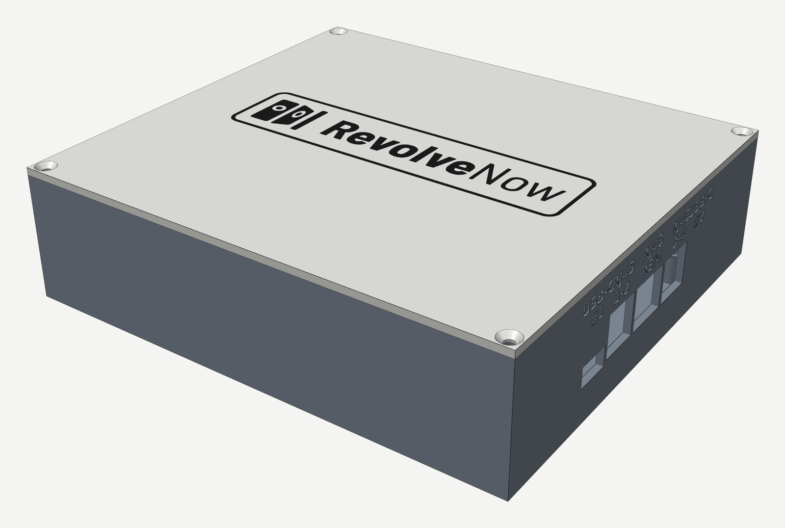
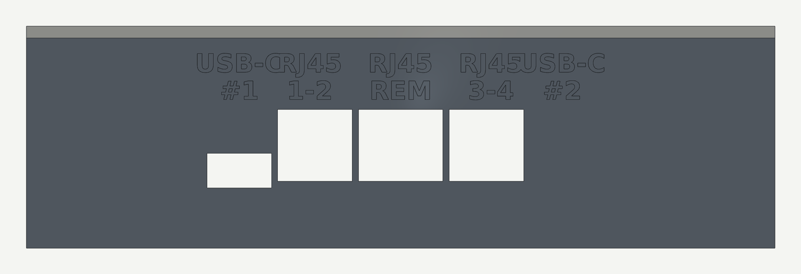
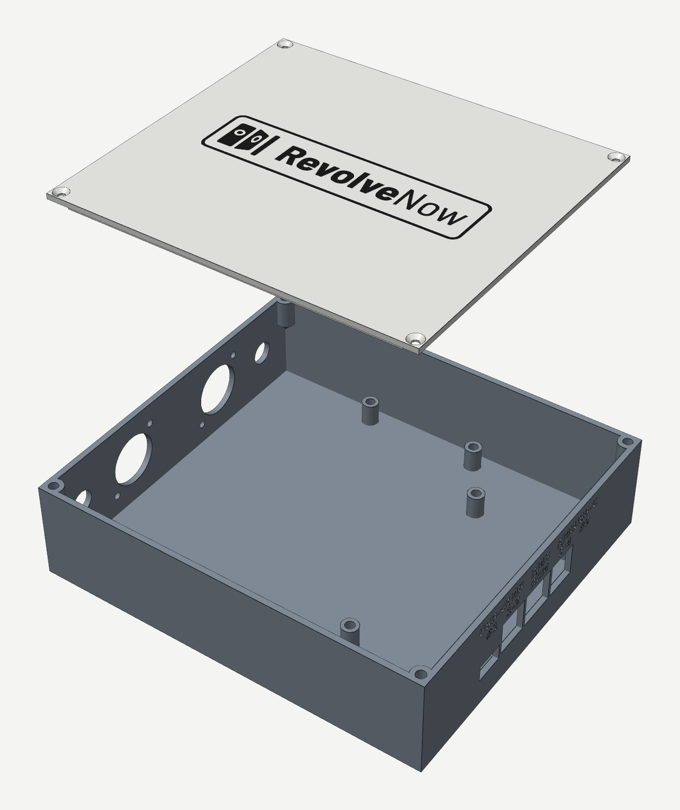

# Relay box

A 3D-printable box for the rev 2 controller board, an 8-channel relay board and two 230 V control-line connectors: a base that holds both boards and a flat lid screwed on from above. The Revolve Now logo sits in a rounded frame on the lid, printed in a second colour, as on the main board's enclosure.



## Files

| Path | What it is |
|---|---|
| `src/relay_box.py` | The parametric model and the only source. Every dimension is a named constant at the top |
| `src/relay_box.FCStd` | The same model in FreeCAD, with stand-ins for the boards, connectors, mating plugs and indicators in a `Placeholders` group |
| `src/export_print.py` | Writes both 3MFs from the STLs through Bambu Studio's CLI |
| `generated/relay_box_rev2.3mf` | A Bambu Studio project for the Bambu Lab P2S, laid out as printed: the base as modelled on plate 1, the lid upside down on plate 2, the logo a part of the lid on filament 2. Printer, process and filament presets are in it |
| `generated/relay_box_rev2-base-fittest.3mf` | The base alone, same presets, for test-fitting the boards before printing the lid |
| `generated/relay_box_rev2-{base,lid,logo}.stl` | Each part as a mesh, in the assembled position, for slicers or printing services that only take STL |

Everything under `generated/` is written by the scripts; edit `src/relay_box.py` and regenerate rather than changing an export.

## What it fits

The box coordinates start at the inner front-left corner, on top of the floor: X runs from the connector wall to the controller, Y from the front wall to the back.

- **Controller board:** rev 2, `hardware/controller/revolvenow_controller.kicad_pcb`, 95 × 50 mm, turned so that its jack edge faces the right wall, centred front to back. Its Ø4.2 corner holes are 4.5 mm in from each edge.
- **Relay board:** an ELEGOO 8-channel 5 V 10 A board (Songle SRD-05VDC-SL-C relays), 56 × 138 mm, long side front to back, outputs facing the connectors. Its holes are 3 mm in from the edges, 132 × 50 mm apart. It sits 8 mm from the controller board (`PCB_GAP`).
- **Right wall:** the controller's five jacks, J7, J3, J9, J5 and J8 from the front. J8 is a knock-out (see [Openings](#openings)).
- **Left wall:** two Amphenol ecomate C016 30C006 100 12 receptacles (6+PE male, solder), and a 10 mm 230 VAC metal indicator beside each, on the outer side. The mating plugs are 90° angled; the receptacles are rolled 45° so the two plugs lie parallel with the cable leaving up and towards the front.
- **Wiring space:** 36 mm free between the connector bodies and the relay board, for the AC wiring (`WIRE_GAP`).
- **Labels:** engraved 0.5 mm into the outside of the walls in 4 mm DejaVu Sans Bold. Above each jack its name, with the jack type above that: `#1` (J7), `1-2` (J3), `REM` (J9, the manual remote control), `3-4` (J5), `#2` (J8). On the left wall `230 V` between the connectors, and `1-2` and `3-4` under them, in the same order from the front.
- **Logo:** 110 mm wide and 0.6 mm deep in the lid top, centred, upright when the front wall faces you. It is read from `webapp/public/revolve-now-logo.svg` at generation time. The `logo` part fills it flush.

## Dimensions

| | mm | Constant |
|---|---|---|
| Outside | 168.4 × 150.8 × 44.8 | derived |
| Inside | 163.6 × 146.0 × 40.0 | derived, `IZ` |
| Base height | 42.4 | `IZ + FLOOR` |
| Lid: plate, and the lip that locates it inside the walls | 2.4, and 3.0 deep | `WALL` |
| Walls and floor | 2.4 | `WALL`, `FLOOR` |
| Relay board to the front and back walls | 4.0 | `MARGIN_Y` |
| Board standoffs: height, diameter | 10.0, 7.0 | `STANDOFF_H`, `STANDOFF_R` |
| Lid bosses in the corners: diameter, height, then a 45° cone below | 8.0, 12.0 | `BOSS_R`, `BOSS_H` |

## Openings



Positions are along the wall from the inner front wall (Y), heights from the top of the floor (Z).

| Opening | Wall | Centre Y | Size | Z |
|---|---|---|---|---|
| J7 USB-C `#1` | right | 40.5 | 13.0 wide × 7.0 tall | 9.75 to 16.75 |
| J3 RJ45 `1-2` | right | 54.75 | 15.05 × 14.5, Y 48.2 to 63.25 | 11.1 to 25.6 |
| J9 RJ45 `REM` | right | 73.0 | 17.0 × 14.5 | 11.1 to 25.6 |
| J5 RJ45 `3-4` | right | 91.25 | 15.05 × 14.5, Y 82.75 to 97.8 | 11.1 to 25.6 |
| J8 USB-C `#2`, knock-out | right | 105.5 | 13.0 × 7.0 | 9.75 to 16.75 |
| 230 V connector `1-2` | left | 46.5 | Ø22.2, with 2 × Ø3.2 flange holes 31 mm apart, rolled 45° | axis 20.0 |
| 230 V connector `3-4` | left | 99.5 | as above | axis 20.0 |
| Indicator by `1-2` | left | 16.5 | Ø10.2 | axis 20.0 |
| Indicator by `3-4` | left | 129.5 | Ø10.2 | axis 20.0 |
| Lid screws | lid | 1.5 from each inner wall | Ø3.4, countersunk to Ø6.8 | |

RJ45 openings start 0.5 mm below the board's top face; USB-C openings are centred on the receptacle, big enough for the plug's overmold. J3 and J5 sit closer to a USB-C than a full RJ45 opening allows, so each gives up width on the USB-C side and keeps a 1.2 mm web (`MIN_WEB`). The script checks that the plug still passes with 0.5 mm to spare (`PLUG_CLEAR`).

The two USB-Cs are bridged on the board (R1/R2), so only one may ever be powered. J8 is therefore closed until it is pushed out from inside: its opening is cut from the inside, leaving a 0.8 mm skin, with a 0.6 mm groove round its edge that leaves 0.4 mm (`KNOCKOUT`).

## Printing



`relay_box_rev2.3mf` opens ready to slice on a Bambu Lab P2S:

| Setting | Value |
|---|---|
| Printer | Bambu Lab P2S 0.4 nozzle |
| Process | 0.20mm Standard @BBL P2S, with 3 walls instead of the preset's 2; 15 % grid infill as in the preset |
| Supports | off |
| Filaments | Bambu PLA Basic @BBL P2S in slot 1 for the body and in slot 2 for the logo; the colours are placeholders, so pick yours |
| Build plate | Textured PEI Plate, the P2S default |

- **Two plates,** because base and lid (each 168.4 × 150.8 mm) do not fit one 256 × 256 mm plate side by side. Plate 1 is the base, open side up; plate 2 is the lid, face down, with the logo and frame as its first three layers and a prime tower for the colour change.
- **With a single filament,** set both slots to it, or pause at 0.6 mm on plate 2 to swap.
- **Sliced headless in Bambu Studio 02.08.02.61:**

| Project | Plate | Time | Filament | Layers |
|---|---|---|---|---|
| `relay_box_rev2.3mf` | 1, base | 2 h 27 min | 129.4 g | 212 |
| | 2, lid | 1 h 25 min | 62.0 g + 1.4 g logo, 3 colour changes | 27 |
| `relay_box_rev2-base-fittest.3mf` | 1, base | 2 h 27 min | 129.4 g | 212 |

- **Floating regions:** Bambu Studio warns that the base has floating regions. They are the tips of the 45° cones under the four lid bosses: each cone starts as a point 1.5 mm from both walls and reaches them 1.5 mm higher, so its first few layers print in the air.

## Hardware and assembly

The script sets the holes, not the fasteners, so only diameters and depths are fixed:

- **Heat-set inserts:** 12 × M3 in Ø4.0 holes: 8 in the board standoffs (9 mm deep) and 4 in the lid bosses (8 mm deep, from the top rim).
- **Board screws:** 8 × M3 into the standoff inserts, 4 per board.
- **Lid screws:** 4 × M3 countersunk, through the 2.4 mm lid into the boss inserts.
- **Connectors:** 2 × M3 per receptacle flange, 31 mm apart.
- **Indicators:** fixed with their own nuts on the inside.

## Check before printing

Nothing here has been measured against a board in hand unless the script says so:

| Part | Assumed | Constant |
|---|---|---|
| ELEGOO relay board | 56 × 138 mm, Ø3.1 holes 132 × 50 apart, from listings; 19 mm tall over the relays and terminal blocks, 3 mm solder pins, typical | `RELAYS["elegoo"]` |
| Controller jacks | typical datasheet sizes, cross-checked against the KiCad 3D models of J3 (RJHSE538X) and J8 (USB4105); J5, J7 and J9 have no model | `JACK` |
| C016 receptacle | Ø22 cutout, 2 × M3 at 31 mm, flange 38 × 29, from the datasheet; flange thickness 4 mm, not in the datasheet, used by the stand-in only | `CONN_*`, `FLANGE_T` |
| Receptacle roll | 45°; the plug's own cable exit relative to the key decides the final roll | `CONN_ROLL` |
| Angled plug | stand-in scaled off the C016 datasheet drawing | `ANGLED_PLUG` |
| Indicator | Ø10 thread, Ø14 head, 14 mm nut across flats: typical for the type, not measured | `LED` |

The script fails if any stand-in intersects the base or the lid, or an indicator a connector or plug, but the stand-ins are only as good as these numbers.

## Regenerating

With FreeCAD 1.1 (`freecadcmd` ships with it; the AppImage takes it as its first argument), then Bambu Studio for the 3MFs:

```bash
freecadcmd hardware/relay_box/src/relay_box.py
# or: FreeCAD.AppImage freecadcmd hardware/relay_box/src/relay_box.py
python3 hardware/relay_box/src/export_print.py
```

The first rewrites `src/relay_box.FCStd` and the STLs, and refuses to save a base or lid that isn't a closed, manifold solid. The second needs Bambu Studio, started once so its presets are on disk, and the `bambu-3mf` script from the cad-tools plugin. The STLs are reproducible byte for byte; the 3MFs are not, because Bambu Studio gives every part a new UUID.
